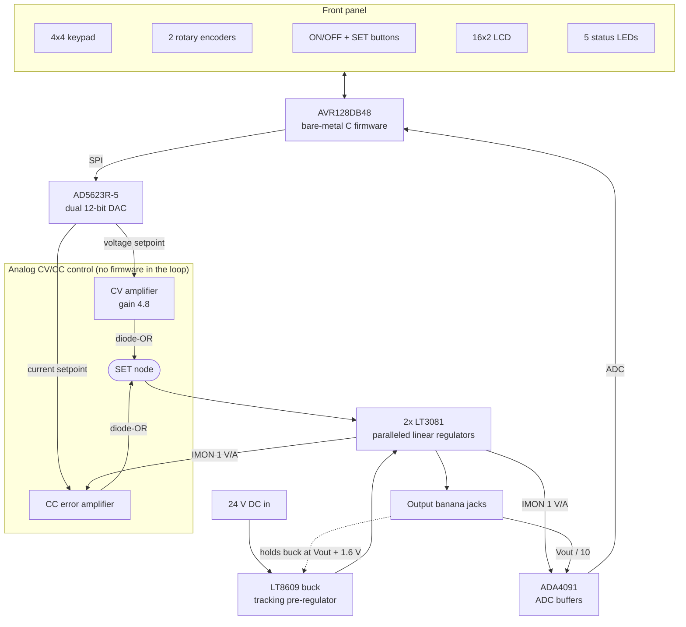

# Programmable Linear Bench Power Supply

**A digitally controlled 0–24 V / 0–3 A bench supply.** An AVR128DB48 running bare-metal C sets analog constant-voltage and constant-current loops through a 12-bit SPI DAC. A switching pre-regulator tracks the output so the linear stage stays cool.


---

## At a glance

| Spec | Value |
|---|---|
| **Input** | 24 V DC (5.5 × 2.5 mm barrel jack) |
| **Output voltage** | 0–24 V setpoint range; about 22 V maximum from a 24 V adapter (input minus regulator headroom) |
| **Current limit** | 0–3 A, from two paralleled 1.5 A LT3081 linear regulators |
| **Regulation** | Analog CV/CC loops with automatic crossover; the firmware is not in the regulation path |
| **Setpoint resolution** | 12-bit DAC: 5.9 mV (voltage), 1.2 mA (current); entered and displayed in 0.01 steps |
| **Measurement** | 12-bit ADC, 4.096 V reference, 64-sample averaging: 10 mV / 1 mA per count |
| **User interface** | 16×2 LCD, 4×4 keypad, 2 rotary encoders, ON/OFF and SET buttons, 5 status LEDs |
| **Controller** | Microchip AVR128DB48 at 4 MHz, register-level C (no Arduino, no HAL), about 5.5 KB of flash |
| **Design tools** | KiCad 9 (3 hierarchical schematic sheets, 87 components, PCB layout), LTspice, Microchip Studio |

## Engineering highlights

- **Current limiting is done in hardware.** Two error amplifiers drive the regulator's SET node through a Schottky diode-OR, and whichever one asks for the lower voltage wins. That gives smooth CV↔CC crossover, and the current limit keeps working even if the firmware is busy or stalled.
- **Tracking pre-regulator.** A 2N3906 level-shift on the LT8609 buck's feedback pin holds its output about 1.6 V above the supply's output. At 5 V / 3 A that keeps the linear stage's dissipation near 5 W, compared with roughly 57 W from a fixed 24 V rail.
- **Paralleled LDOs with current sensing for free.** Two LT3081s share the load through 10 mΩ ballast resistors. Their IMON outputs (I<sub>OUT</sub>/5000) sum into one 5 kΩ resistor, which gives a 1 V/A current signal used by both the CC loop and the ADC.
- **Bare-metal firmware.** Eight driver modules, a non-blocking state machine, interrupt-driven quadrature decoding, debounced inputs, and clamped setpoints. DAC writes are confined to the output-control functions, so the output can't be switched on by accident.
- **Verified before hardware.** The firmware builds with zero warnings for the real target. A host-side simulation runs the actual application code against mocked hardware and passes 36 front-panel scenario checks.

## Skills demonstrated

| Area | Details |
|---|---|
| Analog and power design | Linear regulator paralleling, buck pre-regulation, op-amp error amplifiers and compensation, current sensing, diode-OR control |
| Mixed-signal | SPI DAC control, ADC front-end scaling and buffering, reference selection, resolution budgeting |
| Embedded C | AVR Dx peripherals (SPI, ADC, VREF, PORT interrupts), state machines, ISRs and atomic access, debouncing, fixed-point display formatting |
| PCB / EDA | KiCad 9 hierarchical schematics, footprint selection, PCB layout, 3D review |
| Verification | LTspice transient simulation, host-side firmware simulation with hardware mocks, static analysis with `-Wall -Wextra` |

**Keywords:** programmable power supply, bench power supply, linear regulator, LT3081, LT8609, buck converter, constant voltage, constant current, CV/CC, AD5623R, DAC, ADC, SPI, AVR128DB48, AVR Dx, embedded C, bare-metal, interrupts, rotary encoder, keypad, HD44780 LCD, 74HC595, KiCad, LTspice, PCB design, mixed-signal

---

## System architecture



The microcontroller acts as a **front panel, not a regulator**. It writes two reference voltages and reads back two measurements, while the analog loops regulate continuously.

### Power stage (`Power_Stage.kicad_sch`)
- **Pre-regulator:** an LT8609 synchronous buck (U1) steps 24 V down to about V<sub>OUT</sub> + 1.6 V. Q1 (2N3906) sits at the midpoint of a 100 kΩ / 100 kΩ divider between the buck output and the supply output. Its collector current through 4 kΩ sets the feedback voltage (0.782 V), which fixes the headroom.
- **Output stage:** two LT3081 linear regulators (U2, U3) in parallel with 10 mΩ ballast resistors. Each one's output follows its SET pin.
- **Logic supply:** a second LT8609 (U9) generates the 5 V rail.
- **Sensing:** a 9 kΩ / 1 kΩ divider (÷10) for voltage, and the summed IMON outputs into 5 kΩ for current (1 V/A).

### Setpoint control (`Vset.kicad_sch`)
- **DAC:** an AD5623R-5 dual 12-bit DAC with an internal 2.5 V reference and ×2 output gives 0–5 V on each channel.
- **CV amplifier:** an ADA4091 configured as a non-inverting amplifier with gain 1 + 3.8 kΩ/1 kΩ = 4.8 maps the 0–5 V DAC output to 0–24 V on the SET node.
- **CC amplifier:** an integrating ADA4091 stage (1 nF) compares IMON with the current setpoint. When the load exceeds the limit, it pulls the SET node down through a 1N5819 diode.

### Microcontroller and front panel (`MCU.kicad_sch`)
- **Controller:** AVR128DB48 (TQFP-48), programmed over UPDI.
- **Display and keypad:** a WC1602A 16×2 character LCD in 4-bit mode and a 4×4 keypad matrix using the MCU's internal pull-ups.
- **Knobs:** two Bourns PEC11R encoders with external 10 kΩ pull-ups.
- **LEDs:** a 74HC595 shift register drives five status LEDs (CV, CC, ON, VSET, CSET).
- **ADC buffers:** a second ADA4091 buffers the voltage and current monitor signals into the ADC.

---

## Front panel operation

```
+----------------+
|12.00V    11.98V|   voltage setpoint | measured voltage
| 1.50A     0.42A|   current limit    | measured current
+----------------+
```

| Control | Action |
|---|---|
| **ON/OFF** | Toggles the output. Off drives the DAC to 0 V / 0 A but keeps both setpoints, so the next ON restores them. Works at any time, including mid-entry. |
| **SET** | Cycles normal view → voltage entry → current entry → normal view. Works while the output is off, so limits can be preset before enabling. |
| **Keypad (entry mode)** | Digits shift in from the right, calculator-style (1, 2, 0, 0 → 12.00). `*` backspace, `#` enter, `C` cancel. |
| **Voltage / current knobs** | ±0.01 V or ±0.01 A per detent, clamped to the hardware limits. |
| **LEDs** | ON, CV (regulating voltage), CC (current limiting), VSET / CSET (entry mode). |

---

## Firmware

### Module map

| Module | Responsibility | Pins |
|---|---|---|
| `main.c` | Non-blocking super-loop: one button event and one task per pass. Output on/off, setpoint entry, live readings, CC/CV indication. | — |
| `SPI Module` | SPI0 host, mode 1, 2 MHz, blocking byte transfer | PA4 MOSI, PA6 SCK |
| `DAC Module` | AD5623R command frames, SYNC framing, setpoint scaling (÷4.8 CV gain) and clamping | PA7 SYNC, PA3 LDAC |
| `ADC Module` | 12-bit single-ended conversions, 4.096 V reference, 64× accumulation | PF0 (AIN16), PF1 (AIN17) |
| `LCD Module` | HD44780 4-bit driver; fields are redrawn into a fixed on-screen template | PD0–PD3 data, PD4 E, PD5 R/W, PD6 RS |
| `Keypad Module` | 4×4 matrix scan, debounced, one event per press | PC0–PC3 rows, PC4–PC7 columns |
| `Rotary Encoder Module` | Pin-change ISR, table-based quadrature decoding with bounce rejection, detent accumulation | PE0–PE3 |
| `Buffer Module` | 4-digit fixed-point text model, float ↔ digit conversion with rounding | — |
| `Shift Register Module` | Bit-banged 74HC595 LED driver | PA0 SER, PA1 SRCLK, PA2 RCLK |

### Design decisions
- **Setpoints are the source of truth; the display is a view.** Cancelling an entry just redraws the field from the stored value.
- **Only `apply_setpoints()` / `output_set()` write the DAC, and only while the output is on.** Turning a knob while the output is off can never re-enable it.
- **Encoder edges are counted in an interrupt** and converted to detents in the main loop. Fast turns are not lost, even though a loop pass spends about 10 ms on ADC averaging and LCD writes.
- **Worked DAC example:** a 12.00 V setpoint → 12.00 / 4.8 = 2.50 V at the DAC → code 2048 → SPI frame `00 80 00`.

---

## Verification

| Check | Method | Result |
|---|---|---|
| Target build | avr-gcc with the AVR128DB48 device header, `-Wall -Wextra` | 0 errors, 0 warnings, about 5.5 KB of flash |
| Interrupt wiring | Symbol check of the compiled encoder module | Handler on `PORTE_PORT_vect` (vector 46) |
| Front-panel behavior | Host-side simulation running the real `main.c`, encoder and buffer modules against mocked LCD, buttons, keypad, encoders, DAC and LEDs | 36 / 36 checks pass: presetting while off, setpoint retention across off/on, cancel/restore, ON/OFF mid-entry, no lost encoder clicks, CC indication at the limit, clamping, single toggle on a held button |
| Conversions | Host-side unit checks of DAC frames, display rounding and quadrature decoding | Pass |
| Analog design | LTspice transient models of the tracking pre-regulator with paralleled LT3081s, and of an alternative current-limit topology | See `LTspice/` |

### Status and roadmap
- [x] Schematic capture: 3 hierarchical sheets, 87 components
- [x] PCB layout and 3D review (KiCad 9)
- [x] Firmware: complete feature set, clean target build, simulated front-panel behavior
- [ ] Board bring-up and bench characterization (load regulation, current-limit accuracy, transient response, thermal)
- [ ] Two-point gain/offset calibration of the DAC and ADC paths, stored in EEPROM
- [ ] Remote control over UART (SCPI-style commands)

---

## Repository structure

```
├── main.c                      Application state machine
├── ADC Module/                 ADC_MOD.c / .h
├── Buffer Module/              BUFFER_MOD.c / .h
├── DAC Module/                 DAC_MOD.c / .h
├── Keypad Module/              KEYPAD_MOD.c / .h
├── LCD Module/                 LCD_MOD.c / .h
├── Rotary Encoder Module/      ROT_ENCODER_MOD.c / .h
├── SPI Module/                 SPI_MOD.c / .h
├── Shift Register Module/      SHIFT_REGISTER_MOD.c / .h
├── Power_Supply_Main.cproj     Microchip Studio project
├── KiCad/                      KiCad project, schematic PNGs, 3D render
└── LTspice/                    Simulation captures
```

## Building the firmware

**Microchip Studio 7:**
1. Create a project for the AVR128DB48 with the AVR-Dx device pack.
2. Add `main.c` and every module `.c` file to the project.
3. Add each module folder to the include paths.
4. Define the symbol `F_CPU=4000000UL`.
5. Program the board over UPDI.

**Command line** (avr-gcc with the Microchip AVR-Dx device pack):

```sh
avr-gcc -mmcu=avr128db48 -B "$DFP/gcc/dev/avr128db48" -isystem "$DFP/include" \
        -std=gnu99 -Os -Wall -DF_CPU=4000000UL \
        -I"ADC Module" -I"Buffer Module" -I"DAC Module" -I"Keypad Module" \
        -I"LCD Module" -I"Rotary Encoder Module" -I"SPI Module" -I"Shift Register Module" \
        main.c */*.c -lm -o power_supply.elf
avr-objcopy -O ihex -R .eeprom power_supply.elf power_supply.hex
```

## Design files

| File | Contents |
|---|---|
| `KiCad/PowerSupply.kicad_pro` | KiCad 9 project |
| `KiCad/PowerSupply.kicad_sch` | Root sheet linking the three sub-sheets |
| `KiCad/Power_Stage.kicad_sch` | Pre-regulator, LT3081 output stage, 5 V supply, output jacks |
| `KiCad/Vset.kicad_sch` | Setpoint DAC and CV/CC amplifiers |
| `KiCad/MCU.kicad_sch` | Microcontroller, LCD, keypad, encoders, LEDs, ADC buffers |

### Schematics and simulations

<details>
<summary><b>Power stage</b>: tracking buck, paralleled LT3081s, 5 V supply</summary>


</details>

<details>
<summary><b>Setpoint control</b>: AD5623R DAC, CV and CC amplifiers</summary>


</details>

<details>
<summary><b>Microcontroller</b>: AVR128DB48, LCD, keypad, encoders, LEDs, ADC buffers</summary>


</details>

<details>
<summary><b>LTspice</b>: power path model (tracking pre-regulator into paralleled LT3081s, 4 Ω load)</summary>


</details>

<details>
<summary><b>LTspice</b>: alternative current-limit topology (sense amplifier driving back-to-back MOSFETs)</summary>


</details>

---


**Tarik** · Electrical & Computer Engineering · [GitHub @tarik8mohamed-ux](https://github.com/tarik8mohamed-ux)

